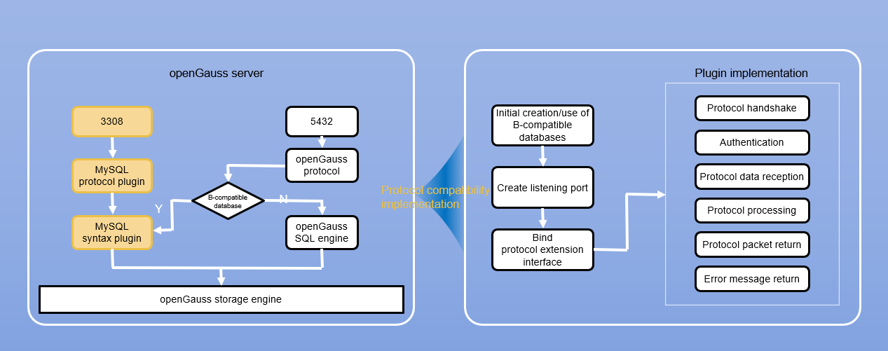

# MySQL Protocol Compatibility

<!-- md-trans-meta sourceCommit=unknown translatedAt=2026-07-30T06:20:49.773Z pushedAt=2026-09-24T09:40:09.474Z -->

- openGauss implements MySQL protocol compatibility in the Dolphin plugin through an abstract protocol layer interface. After configuring the relevant parameters, users can directly connect to openGauss using the MySQL JDBC driver or the MySQL command line client.

## Architecture Diagram



- openGauss starts the relevant listening port number based on the protocol compatibility configuration items. When a user directly connects to the Dolphin protocol listening port number through a MySQL client, openGauss can respond to this network request via the Dolphin protocol compatibility plugin.

## Currently Supported MySQL Client Versions

- MySQL JDBC driver: 8.0.28 and below
- MySQL command line client: 8.0.28 and below

## Constraints

- Cursors are not supported (referring to the method of fetching data through useCursorFetch and setFetchSize in JDBC).
- Execution of stored procedures is not supported.
- For connections established through the MySQL protocol, the parameters dolphin.b_compatibility_mode and enable_set_variable_b_format are automatically set to true.
- openGauss supports the TLS 1.2 protocol standard, whereas some MySQL command line client versions, such as 5.7.27, only support TLS 1 and TLS 1.1. Therefore, connecting to openGauss in SSL mode is not supported for such clients. The TLS versions supported by a client can be viewed using mysql --help.

## Usage

### mysql_native_password Authentication Method

1. Create a B-type database, create a user, and set the MySQL native password (you can grant privileges to the new user using the GRANT command as needed):

    ```SQL
    CREATE DATABASE proto_test_db DBCOMPATIBILITY 'B';
    \c proto_test_db
    CREATE USER proto_test WITH PASSWORD 'xxxxxx';
    SELECT set_native_password('proto_test', 'xxxxxx', '');
    ```

    >[!TIP] Tip
    >The first parameter is the username, the second parameter is the MySQL connection password, and the third parameter is the original password. The original password can be empty or any value when setting for the first time. Subsequent password changes and authentication method changes require the original password for verification.

2. Set the GUC parameter [enable_dolphin_proto](../database_reference/connection_settings.md#enable_dolphin_proto) to on.
3. Set the MySQL protocol listening port number, [dolphin_server_port](../database_reference/connection_settings.md#dolphin_server_port). Note that the port number must be different from the port number that openGauss itself listens on.
4. Set the default database instance name for connection, [dolphin.default_database_name](./dolphin_guc_parameters.md#dolphindefault_database_name).
5. After the configuration is complete, you can connect to openGauss through a MySQL client using the corresponding username and password.

>[!TIP] Tip
>
>- enable_dolphin_proto and dolphin_server_port are POSTMASTER-type parameters, and modifications to them require a restart to take effect.
>- Before connecting to openGauss using a MySQL client, ensure that listen_addresses is correctly configured and that pg_hba allows connections from the IP address of the machine where the MySQL client resides. For details, see [Configuring Client Access Authentication](../database_administration_guide/ssl_certificate_management.md).
>- When connecting through a MySQL client, you can use the following format: mysql -u [user_name] -p --port [dolphin_server_port] -h [opengauss_listen_address].
>- The connectability of the standby server is controlled by the [hot_standby](../database_reference/standby_server.md) and [dolphin_hot_standby](../database_reference/connection_settings.md) parameters.

### caching_sha2_password Authentication Method

1. Create a B-type database, create a user, and set the MySQL caching_sha2 password (you can grant privileges to the new user using the GRANT command as needed):

    ```SQL
    CREATE DATABASE proto_test_db DBCOMPATIBILITY 'B';
    \c proto_test_db
    CREATE USER proto_test WITH PASSWORD 'xxxxxx';
    SELECT set_caching_sha2_password('proto_test', 'xxxxxx', '');
    ```

    >[!TIP] Note (The first parameter is the username, the second parameter is the MySQL connection password, and the third parameter is the original password. The original password can be empty or any value when setting for the first time; subsequent password changes and authentication method changes require the original password for verification.)

2. Set the GUC parameter [enable_dolphin_proto](../database_reference/connection_settings.md#enable_dolphin_proto) to on.
3. Set the MySQL protocol listening port number, [dolphin_server_port](../database_reference/connection_settings.md#dolphin_server_port). Note that the port number must be different from the port number that openGauss itself listens on.
4. Set the default database instance name for connection, [dolphin.default_database_name](./dolphin_guc_parameters.md#dolphindefault_database_name).
5. Set the MySQL SSL file information. The file path does not need to be set and is the data directory.
6. After the configuration is complete, you can connect to openGauss through a MySQL client using the corresponding username and password.

>[!TIP] Tip
>
>- enable_dolphin_proto and dolphin_server_port are POSTMASTER-type parameters, and modifications require a restart to take effect.
>- Before connecting to openGauss using a MySQL client, ensure that listen_addresses is correctly configured and that pg_hba allows connections from the IP address of the machine where the MySQL client resides. See [Configuring Client Access Authentication](../database_administration_guide/ssl_certificate_management.md).
>- When connecting through a MySQL client, you can use the following format: mysql -u [user_name] -p --port [dolphin_server_port] -h [opengauss_listen_address].
>- The connectability of the standby server is controlled by the parameters [hot_standby](../database_reference/standby_server.md) and [dolphin_hot_standby](../database_reference/connection_settings.md).

## Compatibility of Common JDBC Connection Parameters

- zeroDateTimeBehavior
    - Description: This parameter indicates the handling method when the driver encounters a DATETIME value consisting entirely of zeros (which MySQL uses to represent invalid dates). The following options are available: "EXCEPTION": throws an exception indicating that an invalid date and time value has been encountered. "ROUND": rounds the invalid date and time value to the nearest valid date. "CONVERT_TO_NULL": converts the invalid date and time value to NULL.

    - Default Value: EXCEPTION

    - Remarks: When the MySQL JDBC driver version is 5.1.x, the option value is convertToNull; when the version is 8.0.x, the option value is CONVERT_TO_NULL. This parameter's options are case-sensitive. If all uppercase or all lowercase is used, the expected behavior will not be obtained.

- tinyInt1isBit
    - Description: Since the MySQL server silently converts the BIT type to TINYINT(1) when creating a table, this parameter indicates whether the driver should treat the TINYINT(1) data type as the BIT type.

    - Default value: true

- transformedBitIsBoolean
    - Description: This parameter indicates whether, if the driver converts TINYINT(1) to a different type, it should use the BOOLEAN type instead of the BIT type.

    - Default Value: false

    - Remarks: transformedBitIsBoolean only determines whether to directly convert the sqlType in the driver from BIT to Boolean type. Regardless of whether the conversion is performed, the type in Java remains Boolean.

- useOldAliasMetadataBehavior
    - Description: This parameter indicates whether the driver should use the legacy handling of the "AS" clause for columns and tables, that is, only returning the alias (if any) in the ResultSetMetaData.getColumnName() or ResultSetMetaData.getTableName() method, rather than returning the original column name or table name.

    - Default Value: false

    - Remarks: Currently, only getColumnName is supported. When an alias is used to represent an expression rather than a table column, the alias is always returned.

- useaffectedrows
    - Description: This parameter indicates that the 'CLIENT_FOUND_ROWS' flag is not set when connecting to the server. Note that this does not comply with the JDBC specification and will affect most apps that rely on the difference between "found rows" and "affected rows" for DML statements, but it does cause the server to return the correct update count produced by "INSERT ... ON DUPLICATE KEY UPDATE" statements.

    - Default Value: false

    - Remarks: This parameter is currently not supported. MySQL compares whether the new row and the old row are identical before and after an update to determine whether to update the row; openGauss does not perform such a comparison during updates, and therefore openGauss always returns the number of "found rows".

- allowMultiQueries
    - Description: This parameter indicates that ";" is allowed to be used as a delimiter for multiple queries within a single statement.

    - Default Value: false